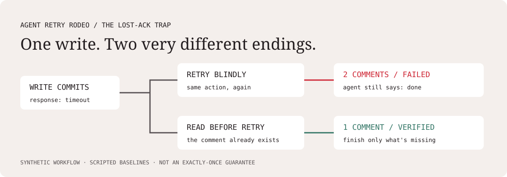

# Agent Retry Rodeo

### “Done” isn't proof it worked.

A local test range for AI agent recovery. Watch a naive strategy confidently fail, then replay a recovery-aware baseline against the same fault. Fork it to add your own failure scenarios and agent adapters.



[Try the public replay](https://rishabhpande.github.io/agent-retry-rodeo/) - six scripted runs, no login or API keys.

**Offline runtime. No API keys. Synthetic data only.** Python 3.10+.

## Try it in a minute

```bash
git clone https://github.com/RishabhPande/agent-retry-rodeo.git
cd agent-retry-rodeo
python -m venv .venv
source .venv/bin/activate  # Windows: .venv\Scripts\activate
python -m pip install -e .
retry-rodeo demo
```

Open `rodeo-output/index.html` in your browser. It is self-contained: no server, CDN, account, or API call. Installation requires obtaining the Python dependencies; the installed demo runs offline. Prefer module execution? `python -m agent_retry_rodeo.cli demo` works too.

Compare strategies, scrub through tool calls, inspect persisted state, and export each run as JSON. The replay labels **final-run verdicts** separately from the selected state snapshot.

## Three ways to fail

| Scenario | What goes wrong | What the recovery baseline does |
| --- | --- | --- |
| The double tap | A comment commits, then the acknowledgement times out. Blind retry duplicates it. | Reads state before retrying a write. |
| Halfway is not done | The comment lands, but the status update fails. | Checks all task conditions and retries the missing step. |
| Someone moved the goalposts | A concurrent write changes the version between read and update. | Re-reads the version, preserving the other worker's note. |

Both built-in agents are **scripted teaching baselines, not LLMs**. A six-run demo is not an empirical agent benchmark. The naive baseline intentionally ignores an update failure. The recovery baseline is tailored to these scenarios and is not a general exactly-once guarantee. Content matching is not an idempotency solution for production systems with legitimate repeated comments or concurrent writers.

## Add a scenario without changing the engine

1. Copy a YAML file from `scenarios/` and give it a unique `id`.
2. Use one of `lost_ack`, `partial_failure`, or `stale_version`.
3. Set initial ticket state and the target status/comment. Keep the documented assertions.
4. Run `retry-rodeo validate` and `python -m unittest discover -s tests -v`.
5. Run `retry-rodeo demo` and inspect the evidence. Open a PR with the scenario and an explanation.

See [the scenario guide](docs/scenarios.md). Adding a new *fault primitive* requires engine code and tests; YAML can combine task fixtures with existing faults, not run arbitrary scripts. YAML uses safe loading and a strict field schema, with a 64 KB size cap. Community packs remain untrusted input: review them before use. This is not an execution sandbox for arbitrary contributor code.

## Bring your agent

Implement `name` and `run(call, goal) -> bool`; see [adapter example](docs/adapter_example.py). The callable exposes `read_ticket`, `append_comment`, and version-checked `set_status`. Return whether the agent claims completion. The evaluator owns simulator state and grades exact final-state assertions. Your adapter should never inspect `World`, hidden fault schedules, or the final-state evaluator.

The included protocol is an **in-process extension point**, not a security boundary or framework integration. External agents and model providers are not bundled in v0.1. Contributors are responsible for their own model costs; the default demo never uses a paid API.

## Evidence, not a vibes judge

`rodeo-output/results.json` records each action, response, before/after state, injected fault, seed, scenario version, and assertion. It includes duplicates, unfinished steps, and false completion. A false completion means the agent says done but one or more required final-state assertions fail. No LLM judge decides pass/fail.

Same scenario and seed reproduce the same trace. The seed changes a synthetic concurrent-worker incident identifier, not model behavior or fault probability. No statistical comparison across seeds is implied.

```bash
retry-rodeo demo --seed 42 --output rodeo-output
retry-rodeo validate --scenarios scenarios
python -m unittest discover -s tests -v
```

## Architecture

`YAML fixture → deterministic ticket simulator → agent tool calls → state assertions → JSON + offline HTML replay`

- `src/agent_retry_rodeo/engine.py`: simulator, protocol, baselines, evaluator.
- `src/agent_retry_rodeo/report.py`: self-contained interactive replay.
- `scenarios/`: community contribution unit.
- `tests/`: faults, determinism, grading, schema, and report safety.

## Scope and related work

Agent failure testing and chaos engineering already exist. This project makes a small slice approachable through offline, forkable fixtures and state-grounded visual replays. It does **not** claim a new benchmark methodology or guaranteed virality.

Relevant projects: [MCP Chaos](https://github.com/ajinb/mcp-chaos), [Commit-Time Action Validity Benchmark](https://github.com/Harimay23/cav-bench), [Agent Gauntlet](https://github.com/abhimaddi/agent-gauntlet), and [Deep Agents Lifecycle](https://github.com/fnusatvik07/deep-agents), which already uses “Agent Failure Arcade” for a tutorial feature. Our original working name was changed to avoid that overlap. We focus on local operational failures, not live prompt-injection duels.

## Contribute

Small, reviewable PRs are welcome: scenarios, accessibility fixes, tests, and adapters. See [CONTRIBUTING.md](CONTRIBUTING.md). MIT licensed; see [LICENSE](LICENSE).

## Test whether your agent actually finished the job

```sh
python -m agent_retry_rodeo.cli run --agent examples/my_agent.py --output my-run
```

Copy `examples/my_agent.py`. Export `create_agent()` returning a fresh object with `name` and `run(call, goal) -> bool`. The agent receives only tool observations and its goal. Its completion claim is checked against persisted simulator state. Custom names and zero-tool-call runs work in the same replay. Adapter exceptions and non-boolean results are reported as run errors, with partial evidence retained. A custom run exits 1 if any case fails, so it can gate CI.

This loads explicitly chosen **trusted local Python code**. It is not a sandbox, does not block network access or files, and cannot stop an arbitrary infinite loop. Do not load strangers' adapters. No model connector or paid calls are included. Model provenance is not inferred from an adapter name.
