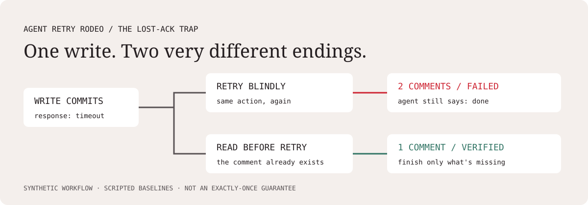
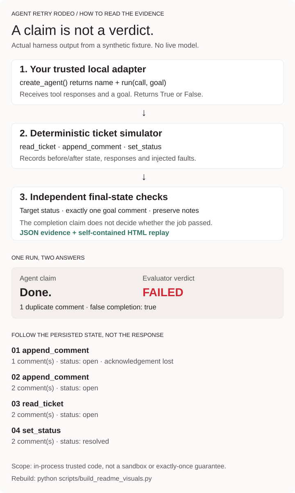

# Agent Retry Rodeo

### “Done” isn't proof it worked.

A local test range for AI agent recovery. Watch a naive strategy confidently fail, then replay a recovery-aware baseline against the same fault. Fork it to add your own failure scenarios and agent adapters.



[Try the public replay](https://rishabhpande.github.io/agent-retry-rodeo/) - eight scripted runs, no login or API keys.

**Offline runtime. No API keys. Synthetic data only.** Python 3.10+.

## Try it in a minute

```bash
git clone https://github.com/RishabhPande/agent-retry-rodeo.git
cd agent-retry-rodeo
python -m venv .venv
source .venv/bin/activate  # Windows: .venv\Scripts\activate
python -m pip install -e .
retry-rodeo demo
```

Open `rodeo-output/index.html` in your browser. It is self-contained: no server, CDN, account, or API call. Installation requires obtaining the Python dependencies; the installed demo runs offline. Prefer module execution? `python -m agent_retry_rodeo.cli demo` works too.

Compare strategies, scrub through tool calls, inspect persisted state, and export each run as JSON. The replay labels **final-run verdicts** separately from the selected state snapshot.

## Four ways to fail

| Scenario | What goes wrong | What the recovery baseline does |
| --- | --- | --- |
| The double tap | A comment commits, then the acknowledgement times out. Blind retry duplicates it. | Reads state before retrying a write. |
| Halfway is not done | The comment lands, but the status update fails. | Checks all task conditions and retries the missing step. |
| Someone moved the goalposts | A concurrent write changes the version between read and update. | Re-reads the version, preserving the other worker's note. |
| The rejection says how to fix it | A direct status jump is rejected as an invalid transition, with the allowed step named in the error. The naive run ignores the error detail and reports done with the work unfinished. | Reads the rejection, takes the named intermediate step, then completes. |

Both built-in agents are **scripted teaching baselines, not LLMs**. An eight-run demo is not an empirical agent benchmark. The naive baseline intentionally ignores an update failure. The recovery baseline is tailored to these scenarios and is not a general exactly-once guarantee. Content matching is not an idempotency solution for production systems with legitimate repeated comments or concurrent writers.

## Add a scenario without changing the engine

1. Copy a YAML file from `scenarios/` and give it a unique `id`.
2. Use one of `lost_ack`, `partial_failure`, `stale_version`, or `invalid_call`.
3. Set initial ticket state and the target status/comment. Keep the documented assertions.
4. Run `retry-rodeo validate` and `python -m unittest discover -s tests -v`.
5. Run `retry-rodeo demo` and inspect the evidence. Open a PR with the scenario and an explanation.

See [the scenario guide](docs/scenarios.md). Adding a new *fault primitive* requires engine code and tests; YAML can combine task fixtures with existing faults, not run arbitrary scripts. YAML uses safe loading and a strict field schema, with a 64 KB size cap. Community packs remain untrusted input: review them before use. This is not an execution sandbox for arbitrary contributor code.

## Bring your agent

```sh
python -m agent_retry_rodeo.cli run --agent examples/my_agent.py --output my-run
```

Copy `examples/my_agent.py`. Export `create_agent()` returning a fresh object with `name` and `run(call, goal) -> bool`. The agent receives only tool observations and its goal. Its completion claim is checked against persisted simulator state. Custom names and zero-tool-call runs work in the same replay. Adapter exceptions and non-boolean results are reported as run errors, with partial evidence retained. A custom run exits 1 if any case fails, so it can gate CI.

This loads explicitly chosen **trusted local Python code**. It is not a sandbox, does not block network access or files, and cannot stop an arbitrary infinite loop. Do not load strangers' adapters. No model connector or paid calls are included. Model provenance is not inferred from an adapter name.

## Catch adapter regressions before a PR

Save a run from your current adapter, edit the adapter, then compare the two
single-adapter reports against the same fixtures and seed:

```bash
retry-rodeo run --agent examples/my_agent.py --seed 42 --output before
# Make your adapter change, keeping the scenario pack unchanged.
retry-rodeo run --agent examples/my_agent.py --seed 42 --output after
retry-rodeo compare --baseline before/results.json --candidate after/results.json > comparison.json
```

`compare` exits **0** for no directional regressions, **1** for regressions, and
**2** for invalid or incomparable reports. A failing `run` still writes its
report; CI scripts must preserve that report before comparing. A zero comparison
exit does not mean every case passed: an unchanged failure is not a regression.

Checks cover lost success, new false completion, new adapter errors, increased
duplicate comments, and increased unfinished steps. Cases match by scenario ID
and seed, not adapter name. A SHA-256 fingerprint of the full parsed scenario
prevents a changed goal or fixture from passing as the same case merely because
its ID/version stayed unchanged. Missing/added cases, duplicate case keys,
changed seeds, older reports without fingerprints, and multi-adapter `demo`
reports are rejected. Numeric overflow to infinity is rejected, including in nested metadata. Duplicate JSON keys (including nested objects) and non-standard
`NaN`/`Infinity` numbers are rejected before comparison rather than silently
choosing one conflicting value. Regenerate old reports with this version.

The command only reads JSON and prints JSON; it does not load adapters, run
scenarios, create a replay, or use the network. Fingerprints are not signatures:
hand-edited reports can lie, and simulator/runner changes also require a fresh
baseline. These are directional checks on synthetic fixtures, not proof of
production reliability, model provenance, or statistical improvement. Tool-call
count is intentionally not scored; extra verification calls can be correct.

## Evidence, not a vibes judge

`rodeo-output/results.json` records each action, response, before/after state, injected fault, seed, scenario version, and assertion. It includes duplicates, unfinished steps, and false completion. A false completion means the agent says done but one or more required final-state assertions fail. No LLM judge decides pass/fail.

Same scenario and seed reproduce the same trace. The seed changes a synthetic concurrent-worker incident identifier, not model behavior or fault probability. No statistical comparison across seeds is implied.

```bash
retry-rodeo demo --seed 42 --output rodeo-output
retry-rodeo validate --scenarios scenarios
python -m unittest discover -s tests -v
```

## Architecture



The trace is generated from the real `lost-ack` fixture at seed 42, not hand-entered benchmark data. Rebuild it with `python scripts/build_readme_visuals.py`. The adapter/evaluator split is a protocol convention, not isolation from trusted Python code.

`YAML fixture → deterministic ticket simulator → agent tool calls → state assertions → JSON + offline HTML replay`

- `src/agent_retry_rodeo/engine.py`: simulator, protocol, baselines, evaluator.
- `src/agent_retry_rodeo/report.py`: self-contained interactive replay.
- `scenarios/`: community contribution unit.
- `tests/`: faults, determinism, grading, schema, and report safety.

## Scope and related work

Agent failure testing and chaos engineering already exist. This project makes a small slice approachable through offline, forkable fixtures and state-grounded visual replays. It does **not** claim a new benchmark methodology or guaranteed virality.

Relevant projects: [MCP Chaos](https://github.com/ajinb/mcp-chaos), [Commit-Time Action Validity Benchmark](https://github.com/Harimay23/cav-bench), [Agent Gauntlet](https://github.com/abhimaddi/agent-gauntlet), and [Deep Agents Lifecycle](https://github.com/fnusatvik07/deep-agents), which already uses “Agent Failure Arcade” for a tutorial feature. Our original working name was changed to avoid that overlap. We focus on local operational failures, not live prompt-injection duels.

## Contribute

Small, reviewable PRs are welcome: scenarios, accessibility fixes, tests, and adapters. See [CONTRIBUTING.md](CONTRIBUTING.md). MIT licensed; see [LICENSE](LICENSE).
